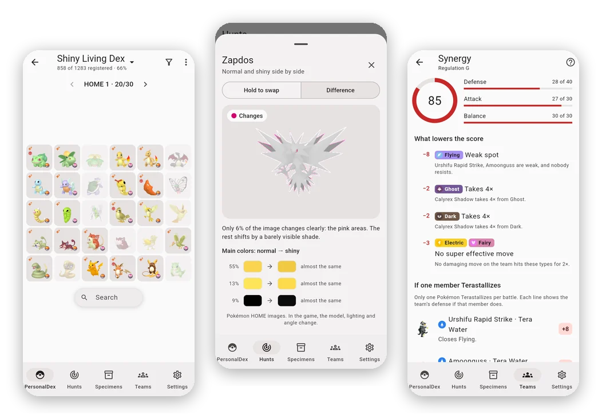
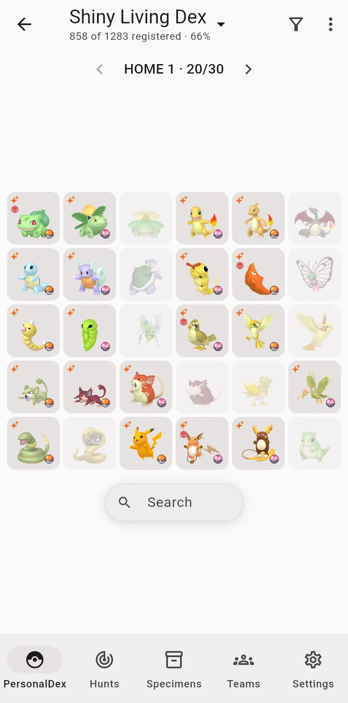
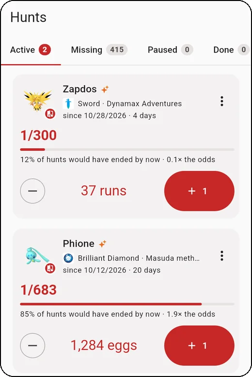
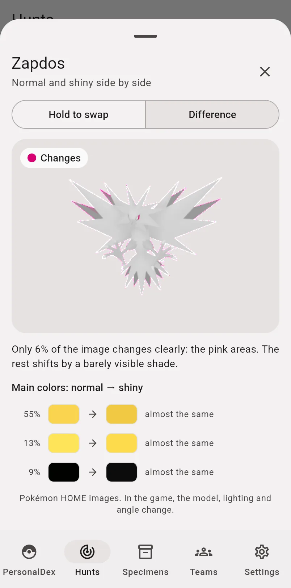
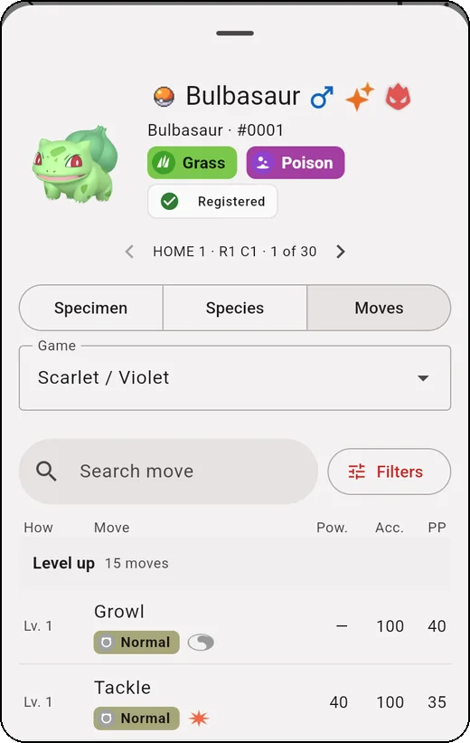
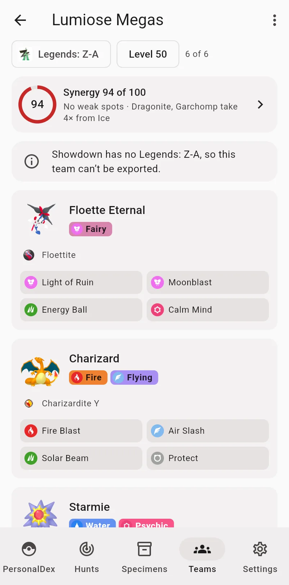
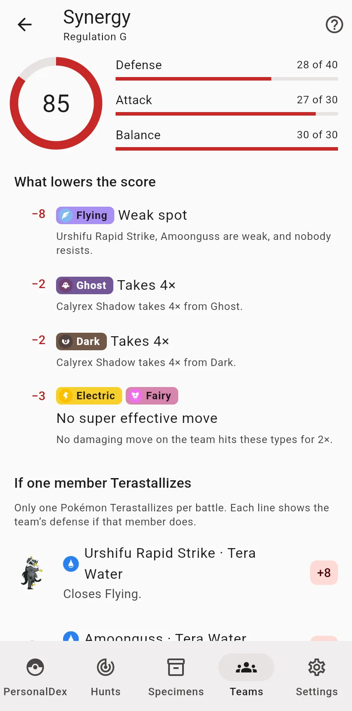

<h1 align="center">iShinyDex</h1>

  <b>Your shiny dex, your hunts and your teams, in the style of Pokémon HOME.</b> 
  Free · No account · Your data stays on your device · Works offline

  <a href="https://nunesvictor.github.io/ishinydex/"><b>▶️ Open iShinyDex</b></a>
  &nbsp;·&nbsp;
  <a href="https://nunesvictor.github.io/ishinydex/demo/">Try the demo</a>
  &nbsp;·&nbsp;
  <b>English</b> · <a href="README.pt-BR.md">Português</a>

  

iShinyDex is for people who hunt shinies and keep a living dex. It lays out
every form in 30-slot boxes the way you'd organize them in HOME, counts your
hunts until the shiny shows up, helps you tell a shiny from the regular one
when they're nearly identical, and builds teams that are legal in the game
you play. It runs in the browser and installs as an app on iPhone, iPad and
desktop, in English and Portuguese.

The [demo](https://nunesvictor.github.io/ishinydex/demo/) comes with sample
data, so you can look around before registering anything.

## What you can do

### Your dex, box by box

Pick a set of forms (the full one with every regional and alternate form,
or a lighter one), regular or shiny, and the app places them in 30-slot
boxes, in the same order you would use in HOME.

What you already have shows in full color; what's missing fades out. Progress
shows per box and per generation, and **Highlight missing** takes you straight
to the gaps.

Tap a slot for the form's sheet: base stats, type matchups, the evolution
line with how each step evolves, and the games where it appears.

 

### Hunts that keep count

Start a hunt from anything still missing in your shiny dex, or from scratch.
You don't need a dex to hunt.

Count with **+1** (hold to count fast) or run a timer. Choose the game and
the method, and the app shows the odds with the Shiny Charm and how lucky
you've been so far. Pause, switch to another hunt and come back without
losing a count.

When the shiny shows up, tap **Found it!**: the specimen comes pre-filled,
and you get a hunt card to share.

 

### Is it really shiny?

Some shinies are almost identical to the regular form. Tap a hunt's sprite
to see both side by side, or hold your finger on the shiny to swap it for
the regular one in the same spot.

For the hard cases there's the **Difference** mode. The app compares the
two images pixel by pixel, paints in pink what actually changes and lists
the main colors before and after. On Zapdos, only 6% of the image really
changes: the eyes.

 

### Every move, in every game

See what each form learns in each game, by level, TM, egg or tutor, with
power, accuracy and PP as they were in that game.

Search every move by type, category and target, and see who learns it. Add
several forms to find the moves they all learn.

 

### Teams that are legal in your game

Build teams of up to six for the game you play, from Ruby / Sapphire to
Scarlet / Violet, Legends: Z-A included. Only the forms, moves, abilities and
held items of that game show up.

Set the nature, Tera, EVs and IVs, and the stats are calculated at the
team's level. Link a member to a specimen you own, and export the team to
Showdown in one tap.

 

### How good is your team?

**Synergy** scores the team from 0 to 100, split into defense, attack and
balance, and explains every point it loses: a weakness several members
share, 4× weaknesses, types no move hits hard.

It shows what each member's Tera would change, and it suggests fixes: moves
your team already learns, and forms that close the gaps, starting with the
ones you own.

 

### And also

- **Specimens:** an inventory of everything you own, with filters (rarity,
  game, status, type, generation…), bulk editing and the list of what's
  **Away from HOME**.
- **Trainers and saves:** your OTs and the saves of each game. They tell
  where each form can be hunted and which methods apply.
- **Shiny locks:** forms with no shiny, or distribution only, are marked.
  You can add your own.

The screenshots use made-up sample data.

## Get it on your device

iShinyDex runs in the browser. Installed, it opens full screen with its own
icon, like an app.

**iPhone and iPad:** open the [app](https://nunesvictor.github.io/ishinydex/)
in **Safari** → **Share** (on iOS 26 and later, in the **⋯** menu next to the
address) → **Add to Home Screen**. Always use it from that icon: the
installed app keeps its data apart from Safari.

> [!WARNING]
> On iPhone and iPad, removing the icon deletes the app's data, and adding
> it again creates an empty app. Before reinstalling, keep Dropbox sync on,
> or use **Export data** and import the file in the new app.

**Desktop (Chrome or Edge):** open the
[app](https://nunesvictor.github.io/ishinydex/) and click **Install** in the
address bar.

When a new version is out, the app offers a **Reload** button. The language
follows your device; change it in **Settings → Language**.

## Your data stays yours

There's no server and no account. Everything you register lives on your
device, and nobody else can see it, not even the project's maintainer. No
tracking, no analytics, no ads: see the
[privacy policy](https://nunesvictor.github.io/ishinydex/privacy/).

Because the data lives on the device, clearing the site's data or removing
the app takes it along. Two ways to keep it safe:

- **Export and import** (Settings → Your data): one `.json` file with
  everything. On import, you choose to **replace** this device's data or
  **merge** both; when the same record changed on both sides, the newest
  change wins. The same file moves your data to another device.
- **Sync with Dropbox** (optional): your desktop, iPhone and iPad share the
  same data, with an automatic backup in your own account.

How Dropbox sync works

1. In **Settings → Your data → Sync**, tap **Connect to Dropbox** and
   authorize it.
2. Repeat on each device. If both the device and Dropbox already have data,
   the app asks: **Merge both** (recommended), **Use only Dropbox's** or
   **Use only this device's**.

From then on it syncs on its own: when the app opens, when you come back to
it, a few seconds after each change and when you pull the dex list to
refresh. There's also a **Sync now** button. Offline, changes wait for the
connection.

- The app only sees **its own folder**, inside `Apps` in your Dropbox, where
  it writes a single file (`ishinydex.json`).
- **Disconnect** only turns sync off: the data stays on the device and in
  Dropbox.
- If you see "Couldn't sync" because access expired, disconnect and connect
  again.

## Host your own copy

The link above is the maintainer's copy. You can publish your own, for
free, on your GitHub Pages: the data of whoever uses it stays on their
devices, and your copy never talks to this one.

Step by step

1. **Fork** this repository on GitHub.
2. In the fork, open **Actions** and enable the workflows (GitHub turns them
   off in forks).
3. In **Settings → Pages**, choose **Source: GitHub Actions**.
4. Publish: **Actions → Pages → Run workflow** (on `main`). The app will be
   at `https://<your-user>.github.io/<repository-name>/`. To also publish
   from `v*` tags, like here, allow that pattern in **Settings →
   Environments → github-pages**.
5. **Dropbox (optional):** without this step, your copy works without sync
   (export and import still work).
   1. At [dropbox.com/developers/apps](https://www.dropbox.com/developers/apps),
      create an app: **Scoped access** → **App folder**.
   2. In **Permissions**, check `files.content.read`, `files.content.write`
      and `account_info.read` and click **Submit**.
   3. In **Settings → OAuth 2 → Redirect URIs**, add the exact address of
      your copy, with the trailing slash
      (`https://<your-user>.github.io/<repository-name>/`).
   4. Copy the **App key** (it's public; the *App secret* isn't used) and
      save it in the fork under **Settings → Secrets and variables →
      Actions → Variables**, named `DROPBOX_APP_KEY`.
   5. Publish again (step 4).

   While the Dropbox app is in development, only your account can connect.
   To let other people in, use **Enable additional users** in the Dropbox
   console (up to 500 accounts; from 50 on, Dropbox requires the production
   request).

Only the build downloads the catalog, from the
[ishinydex-backend](https://github.com/nunesvictor/ishinydex-backend/releases)
releases.

## Legal notice

iShinyDex is a free, non-profit fan project. Pokémon and the related names,
images and trademarks are property of Nintendo, Creatures, GAME FREAK and
The Pokémon Company. Reference data comes from [PokéAPI](https://pokeapi.co/)
and images from the [PokeAPI/sprites](https://github.com/PokeAPI/sprites)
repository. The held items of each game and the Legends: Z-A moves come from
[Pokémon Showdown](https://github.com/smogon/pokemon-showdown) (MIT). The
game, type and origin mark icons, in the Pokémon HOME style, come from the
[Bulbagarden Archives](https://archives.bulbagarden.net/), and the curated
lists (shiny locks, shiny methods and odds, forms per game) were checked
against [Bulbapedia](https://bulbapedia.bulbagarden.net/). iShinyDex is not
affiliated with any of these companies or sites, nor with Dropbox.

## License

The iShinyDex code (this repository, the
[backend](https://github.com/nunesvictor/ishinydex-backend) and the
[frontend](https://github.com/nunesvictor/ishinydex-frontend)) is under the
[MIT license](LICENSE). The license does not cover Pokémon names, images and
trademarks, nor third-party icons, sprites and data (see the legal notice
above and each repository's README); those keep their own terms.

## For developers

| Folder | Repository | What it is |
| --- | --- | --- |
| `frontend/` | [ishinydex-frontend](https://github.com/nunesvictor/ishinydex-frontend) | The app (Flutter) |
| `backend/` | [ishinydex-backend](https://github.com/nunesvictor/ishinydex-backend) | Builds the catalog (reference data, from PokéAPI and Showdown) |

This repository joins both as **git submodules**, publishes the app to
GitHub Pages on each `v*` tag and holds the releases. Workflow and
versioning: [CONTRIBUTING.md](CONTRIBUTING.md) (in Portuguese). Issues and
ideas: [issues](https://github.com/nunesvictor/ishinydex/issues).

Up to `v1.0.0`, iShinyDex was a server (Django + Postgres) running with
`docker compose`. Since `v2.0.0`, the data lives on the devices.
