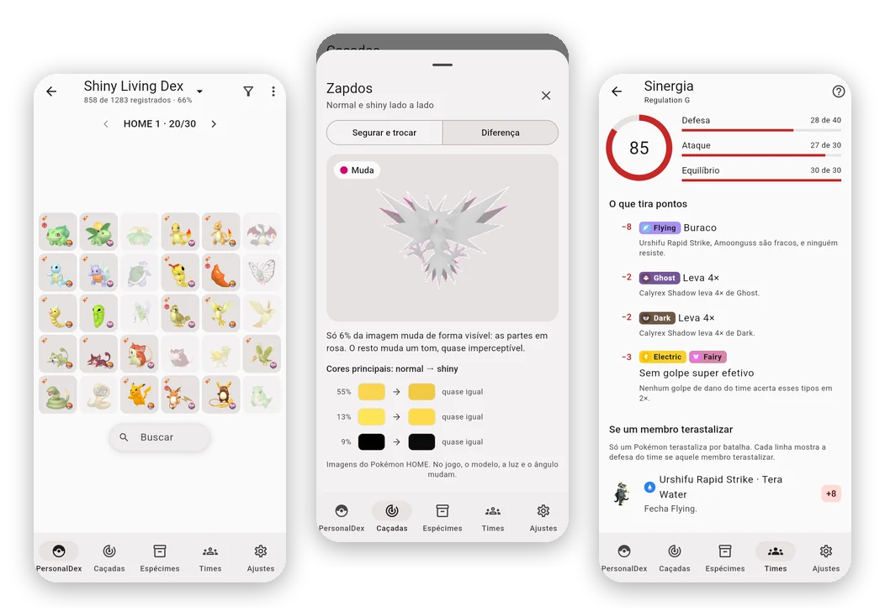

<h1 align="center">iShinyDex</h1>

  <b>Seu shiny dex, suas caçadas e seus times, no estilo do Pokémon HOME.</b> 
  Gratuito · Sem conta · Seus dados ficam no seu aparelho · Funciona offline

  <a href="https://nunesvictor.github.io/ishinydex/"><b>▶️ Abrir o iShinyDex</b></a>
  &nbsp;·&nbsp;
  <a href="https://nunesvictor.github.io/ishinydex/demo/">Ver a demonstração</a>
  &nbsp;·&nbsp;
  <a href="README.md">English</a> · <b>Português</b>

  

O iShinyDex é para quem caça shiny e monta living dex. Ele organiza todas as
formas em boxes de 30 slots, do jeito que você faria no HOME, conta as suas
caçadas até o shiny aparecer, ajuda a diferenciar o shiny do normal quando
os dois são quase iguais e monta times que valem no jogo que você joga. Roda
no navegador e instala como app no iPhone, no iPad e no computador, em
português e em inglês.

A [demonstração](https://nunesvictor.github.io/ishinydex/demo/) vem com
dados de exemplo, para você conhecer o app antes de cadastrar qualquer coisa.

## O que dá para fazer

### Seu dex, box por box

Escolha um conjunto de formas (o completo, com todas as formas regionais e
alternativas, ou um mais enxuto), normal ou shiny, e o app as distribui em
boxes de 30 slots, na mesma ordem que você usaria no HOME.

O que você já tem aparece em cores; o que falta fica apagado. O progresso
aparece por box e por geração, e o **Destacar faltantes** leva direto aos
buracos.

Toque num slot para ver a ficha da forma: os status, as forças e fraquezas
pelos tipos, a linha evolutiva com o método de cada evolução e os jogos em
que ela aparece.

 

### Caçadas que contam por você

Comece uma caçada a partir do que falta no seu shiny dex, ou do zero. Não
precisa ter um dex para caçar.

Conte com o **+1** (segure para contar rápido) ou use o cronômetro. Escolha
o jogo e o método, e o app mostra as odds com o Shiny Charm e quanta sorte
você teve até agora. Pause, troque de caçada e volte sem perder a contagem.

Quando o shiny aparecer, toque em **Encontrei!**: o espécime já sai
preenchido, e você ganha um card da caçada para compartilhar.

 

### É shiny mesmo?

Alguns shinies são quase iguais à forma normal. Toque no sprite de uma
caçada para ver os dois lado a lado, ou segure o dedo no shiny para trocá-lo
pelo normal no mesmo lugar.

Para os casos difíceis, há o modo **Diferença**. O app compara as duas
imagens pixel a pixel, pinta de rosa o que muda de verdade e mostra as
cores principais, antes e depois. No Zapdos, só 6% da imagem muda de fato:
os olhos.

 

### Todos os golpes, em todos os jogos

Veja o que cada forma aprende em cada jogo, por nível, TM, ovo ou tutor,
com o poder, a precisão e o PP daquele jogo.

Busque qualquer golpe por tipo, categoria e alvo, e veja quem aprende.
Junte várias formas para achar os golpes que todas aprendem.

 

### Times que valem no seu jogo

Monte times de até seis para o jogo que você joga, do Ruby / Sapphire ao
Scarlet / Violet, Legends: Z-A incluído. Só aparecem as formas, os golpes,
as habilidades e os itens daquele jogo.

Escolha a natureza, o Tera, os EVs e os IVs, e os stats saem calculados no
nível do time. Ligue um membro a um espécime seu e exporte o time para o
Showdown com um toque.

 

### Seu time é bom?

A **Sinergia** dá ao time uma nota de 0 a 100, dividida em defesa, ataque e
equilíbrio, e explica cada ponto perdido: uma fraqueza que vários membros
têm em comum, fraquezas 4×, tipos que nenhum golpe acerta em cheio.

Ela mostra o que o Tera de cada membro mudaria e sugere ajustes: golpes que
o time já aprende e formas que fecham os buracos, começando pelas que você
já tem.

 

### E mais

- **Espécimes:** o inventário de tudo o que você tem, com filtros
  (raridade, jogo, situação, tipo, geração…), edição em lote e a lista do
  que está **Fora do HOME**.
- **Treinadores e saves:** os seus OTs e os saves de cada jogo. Eles dizem
  onde cada forma pode ser caçada e quais métodos valem.
- **Shiny locks:** as formas sem shiny, ou só por distribuição, ficam
  marcadas. Você pode cadastrar outras.

Os prints usam dados de exemplo inventados.

## Instale no seu aparelho

O iShinyDex roda no navegador. Instalado, ele abre em tela cheia, com ícone
próprio, como um app.

**iPhone e iPad:** abra o [app](https://nunesvictor.github.io/ishinydex/) no
**Safari** → **Compartilhar** (no iOS 26 e mais novos, no menu **⋯** ao lado
do endereço) → **Adicionar à Tela de Início**. Use sempre por esse ícone: o
app instalado guarda os dados separados do Safari.

> [!WARNING]
> No iPhone e no iPad, remover o ícone apaga os dados do app, e adicionar de
> novo cria um app vazio. Antes de reinstalar, deixe a sincronização com o
> Dropbox ligada, ou use **Exportar dados** e importe o arquivo no app novo.

**Computador (Chrome ou Edge):** abra o
[app](https://nunesvictor.github.io/ishinydex/) e clique em **Instalar** na
barra de endereço.

Quando sai uma versão nova, o app oferece o botão **Recarregar**. O idioma
segue o do aparelho; para trocar, use **Ajustes → Idioma**.

## Seus dados são seus

Não há servidor nem conta. Tudo o que você cadastra fica no seu aparelho, e
ninguém mais vê, nem quem mantém o projeto. Sem rastreamento, sem análise de
uso, sem anúncios: veja a
[política de privacidade](https://nunesvictor.github.io/ishinydex/privacidade/).

Como os dados ficam no aparelho, apagar os dados do site ou remover o app
leva tudo junto. Dois jeitos de se proteger:

- **Exportar e importar** (Ajustes → Seus dados): um arquivo `.json` com
  tudo. Ao importar, você escolhe **substituir** os dados deste aparelho ou
  **juntar** os dois; se o mesmo registro mudou nos dois lados, vale a
  mudança mais recente. O mesmo arquivo leva seus dados para outro aparelho.
- **Sincronizar com o Dropbox** (opcional): PC, iPhone e iPad ficam com os
  mesmos dados, com um backup automático na sua própria conta.

Como funciona a sincronização com o Dropbox

1. Em **Ajustes → Seus dados → Sincronização**, toque em **Conectar ao
   Dropbox** e autorize.
2. Repita em cada aparelho. Se o aparelho e o Dropbox já tiverem dados, o
   app pergunta: **Juntar os dois** (recomendado), **Usar só os do Dropbox**
   ou **Usar só os deste aparelho**.

Daí em diante, ele sincroniza sozinho: ao abrir o app, ao voltar para ele,
alguns segundos depois de cada mudança e quando você puxa a lista de dexes
para atualizar. Também há o botão **Sincronizar agora**. Sem internet, as
mudanças esperam a conexão voltar.

- O app só enxerga **a pasta dele**, dentro de `Apps` no seu Dropbox, onde
  grava um único arquivo (`ishinydex.json`).
- **Desconectar** só desliga a sincronização: os dados continuam no aparelho
  e no Dropbox.
- Se aparecer "Não foi possível sincronizar" porque o acesso expirou,
  desconecte e conecte de novo.

## Hospede sua cópia

O link acima é a cópia de quem mantém o projeto. Você pode publicar a sua,
de graça, no seu GitHub Pages: os dados de quem usa ficam nos aparelhos
dessas pessoas, e a sua cópia nunca fala com esta.

Passo a passo

1. Faça um **fork** deste repositório no GitHub.
2. No fork, abra **Actions** e ative os workflows (o GitHub os deixa
   desligados em forks).
3. Em **Settings → Pages**, escolha **Source: GitHub Actions**.
4. Publique: **Actions → Pages → Run workflow** (na `main`). O app fica em
   `https://<seu-usuário>.github.io/<nome-do-repositório>/`. Para publicar
   também por tags `v*`, como aqui, permita esse padrão em **Settings →
   Environments → github-pages**.
5. **Dropbox (opcional):** sem este passo, a sua cópia funciona sem a
   sincronização (exportar e importar continuam valendo).
   1. Em [dropbox.com/developers/apps](https://www.dropbox.com/developers/apps),
      crie um app: **Scoped access** → **App folder**.
   2. Em **Permissions**, marque `files.content.read`, `files.content.write` e
      `account_info.read` e clique em **Submit**.
   3. Em **Settings → OAuth 2 → Redirect URIs**, adicione o endereço exato da
      sua cópia, com a barra no final
      (`https://<seu-usuário>.github.io/<nome-do-repositório>/`).
   4. Copie a **App key** (é pública; o *App secret* não é usado) e grave-a
      no fork em **Settings → Secrets and variables → Actions → Variables**,
      com o nome `DROPBOX_APP_KEY`.
   5. Publique de novo (passo 4).

   Enquanto o app do Dropbox estiver em desenvolvimento, só a sua conta
   conecta. Para liberar outras pessoas, use **Enable additional users** no
   painel do Dropbox (até 500 contas; a partir de 50, o Dropbox exige o
   pedido de produção).

Só o build baixa o catálogo, das releases do
[ishinydex-backend](https://github.com/nunesvictor/ishinydex-backend/releases).

## Aviso legal

O iShinyDex é um projeto de fã, gratuito e sem fins lucrativos. Pokémon e os
nomes, imagens e marcas relacionados são propriedade da Nintendo, Creatures,
GAME FREAK e The Pokémon Company. Os dados de referência vêm da
[PokéAPI](https://pokeapi.co/) e as imagens do repositório
[PokeAPI/sprites](https://github.com/PokeAPI/sprites). Os itens seguráveis
de cada jogo e os golpes do Legends: Z-A vêm do
[Pokémon Showdown](https://github.com/smogon/pokemon-showdown) (MIT). Os
ícones de jogo, de tipo e das marcas de origem, no estilo do Pokémon HOME,
vêm da [Bulbagarden Archives](https://archives.bulbagarden.net/), e as
listas curadas (shiny locks, métodos e odds de shiny, formas por jogo) foram
conferidas na [Bulbapedia](https://bulbapedia.bulbagarden.net/). O
iShinyDex não é afiliado a nenhuma dessas empresas ou sites, nem ao Dropbox.

## Licença

O código do iShinyDex (este repositório, o
[backend](https://github.com/nunesvictor/ishinydex-backend) e o
[frontend](https://github.com/nunesvictor/ishinydex-frontend)) está sob a
[licença MIT](LICENSE). A licença não cobre os nomes, as imagens e as marcas
de Pokémon, nem os ícones, sprites e dados de terceiros (veja o aviso legal
acima e o README de cada repositório); esses seguem os termos deles.

## Para quem desenvolve

| Pasta | Repositório | O que é |
| --- | --- | --- |
| `frontend/` | [ishinydex-frontend](https://github.com/nunesvictor/ishinydex-frontend) | O app (Flutter) |
| `backend/` | [ishinydex-backend](https://github.com/nunesvictor/ishinydex-backend) | Gera o catálogo (dados de referência, da PokéAPI e do Showdown) |

Este repositório junta os dois como **git submodules**, publica o app no
GitHub Pages a cada tag `v*` e guarda as releases. Fluxo de trabalho e
versões: [CONTRIBUTING.md](CONTRIBUTING.md) (em português). Problemas e
sugestões: [issues](https://github.com/nunesvictor/ishinydex/issues).

Até a `v1.0.0`, o iShinyDex era um servidor (Django + Postgres) rodando com
`docker compose`. A partir da `v2.0.0`, os dados ficam nos aparelhos.
