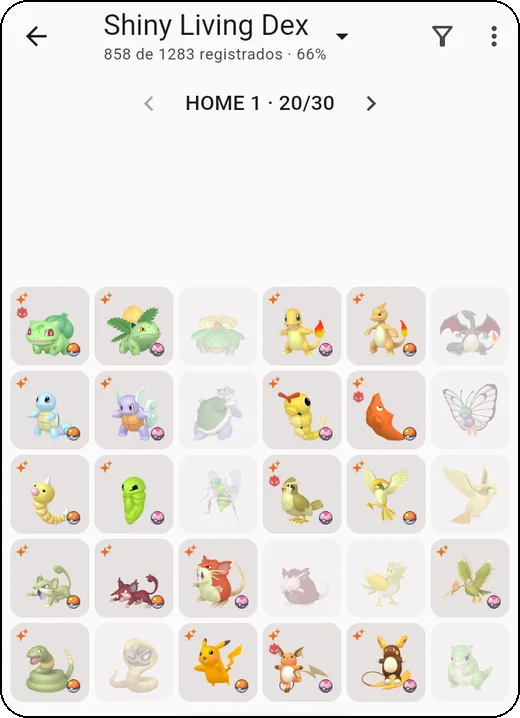
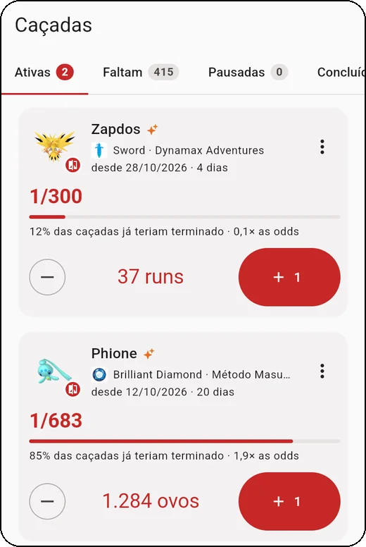
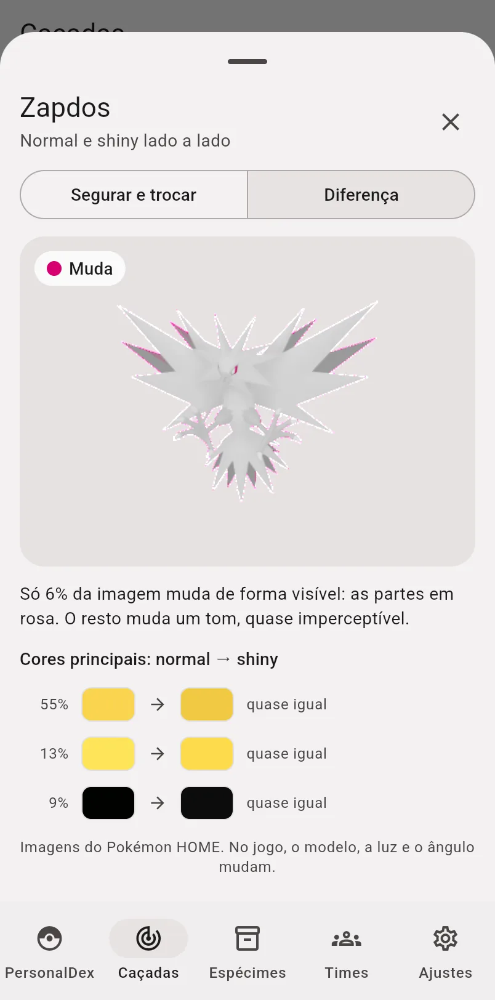
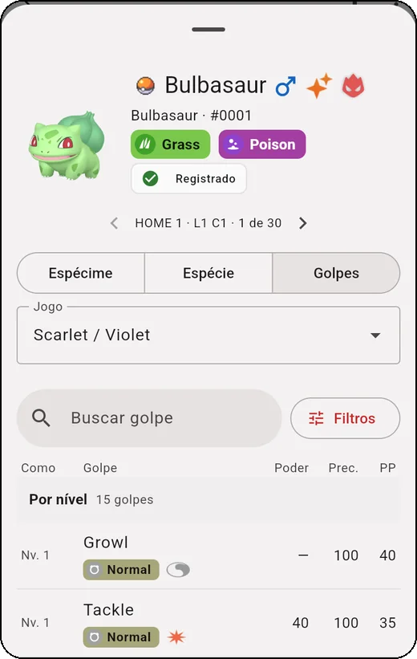
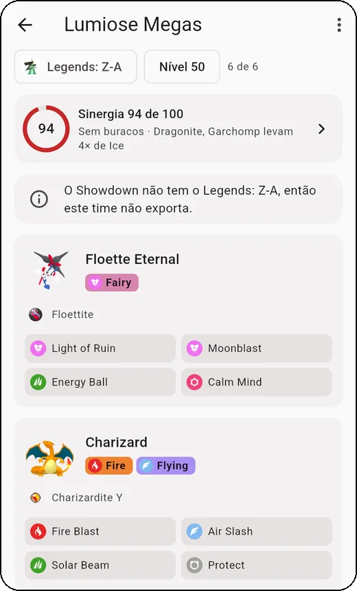
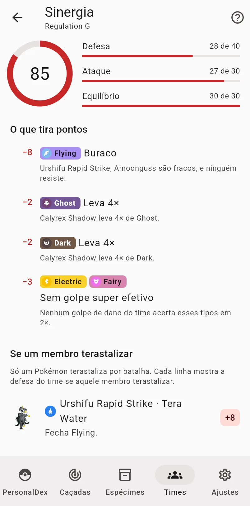

# iShinyDex

[English](README.md) · **Português**

Organize sua coleção de Pokémon no estilo das boxes do **Pokémon HOME** e
acompanhe as suas caçadas de shiny. Monte o seu PersonalDex (com o conjunto
padrão de formas, normal ou shiny), veja o que falta em cada box, cadastre
os espécimes (shiny, alfa, pokébola, treinador, data de captura…) e conte
os encontros de cada caçada até o shiny aparecer.

### ▶️ [Abrir o iShinyDex](https://nunesvictor.github.io/ishinydex/)

Quer só dar uma olhada? A
[**demonstração**](https://nunesvictor.github.io/ishinydex/demo/) vem com
dados de exemplo, que somem ao recarregar a página.

- **Sem conta e sem servidor:** seus dados ficam no seu aparelho.
- **Funciona offline**, depois de aberto uma vez.
- **Instala como app** no iPhone, no iPad e no computador.
- **Sincronização opcional** com o seu Dropbox, para ter os mesmos dados em
  todos os aparelhos.
- **Em português e em inglês.**

## O que dá para fazer

- **PersonalDex:** as boxes de 30 slots, como no HOME, com o progresso por
  box e por geração e o destaque do que falta. Cada slot mostra a forma e o
  espécime depositado, com os status, as forças e fraquezas pelos tipos, a
  linha evolutiva e em quais jogos ela aparece. Deslize para passar de um
  slot para o outro.
- **Espécimes:** o inventário de tudo o que você tem, com filtros (raridade,
  jogo, situação, tipo, geração…), edição em lote, o envio para um jogo e a
  lista do que está **Fora do HOME**.
- **Caçadas:** a lista do que falta em shiny no seu shiny dex, e as caçadas
  em andamento, com contador (+1, segurar para contar rápido) ou cronômetro,
  o método do jogo, as odds com o Shiny Charm e as pausas. No "Encontrei!",
  o espécime já sai preenchido, e o app oferece um **card da caçada** para
  compartilhar. As caçadas não dependem de ter um dex.
- **Shiny × normal:** toque no sprite de uma caçada para comparar o shiny
  com o normal, lado a lado ou segurando o dedo para trocar um pelo outro no
  mesmo lugar. Nos casos sutis (Zapdos, Phione), o modo **Diferença** pinta
  de rosa o que muda de verdade e mostra as cores principais, antes e depois.
- **Golpes:** o que cada forma aprende em cada jogo (nível, TM, ovo, tutor),
  com poder, precisão e PP, e a busca em todos os golpes por tipo,
  categoria, alvo e quem aprende.
- **Times:** times de até 6 que valem no jogo escolhido (da 3ª geração em
  diante, Legends: Z-A incluído): forma, golpes, habilidade, natureza, item,
  Tera, EVs e IVs, com os stats calculados. Ligue um membro a um espécime do
  inventário e exporte o time para o Showdown.
- **Sinergia do time:** uma nota de 0 a 100 (defesa, ataque e equilíbrio)
  com o que tira pontos, o Tera de cada membro sozinho e sugestões: golpes
  que o time já aprende e formas que fecham os buracos, as do seu inventário
  primeiro.
- **Treinadores e saves:** os seus OTs e os saves de cada jogo, que dizem em
  quais jogos cada forma pode ser caçada e quais métodos valem.
- **Shiny locks:** as formas que não têm shiny (ou só por distribuição)
  ficam marcadas, e você pode cadastrar outras.

<table>
<tr><td align="center" width="33%"> PersonalDex</td><td align="center" width="33%"> Caçadas</td><td align="center" width="33%"> Shiny × normal (Diferença)</td></tr>
<tr><td align="center" width="33%"> Golpes</td><td align="center" width="33%"> Times</td><td align="center" width="33%"> Sinergia do time</td></tr>
</table>

Telas do app com dados de exemplo inventados.

## Instalar

O iShinyDex roda no navegador. Instalado, ele abre em tela cheia, com ícone
próprio, como um app.

**iPhone e iPad**
1. Abra o [link do app](https://nunesvictor.github.io/ishinydex/) no
   **Safari**.
2. Toque em **Compartilhar** (o quadrado com a seta; no iOS 26 e mais novos,
   ele fica no menu **⋯** ao lado do endereço) → **Adicionar à Tela de
   Início** → **Adicionar**.
3. Use sempre pelo ícone da Tela de Início. No iPhone e no iPad, o app
   instalado guarda os dados separados do Safari.

> **Cuidado ao reinstalar.** No iPhone e no iPad, remover o ícone apaga os
> dados do app instalado (e o login do Dropbox), e adicionar de novo cria um
> app vazio. Antes de reinstalar (por exemplo, para trocar o ícone depois de
> uma atualização), deixe a sincronização com o Dropbox ligada e conecte de
> novo no app novo, ou use **Exportar dados** e importe o arquivo nele.

**Computador (Chrome ou Edge)**
1. Abra o [link do app](https://nunesvictor.github.io/ishinydex/).
2. Clique no ícone de **instalar** na barra de endereço (ou procure a opção
   de instalar no menu ⋮ do navegador).

Também dá para usar direto no navegador, sem instalar.

**Atualizações:** quando sai uma versão nova, o app avisa ("Nova versão do
iShinyDex disponível") com o botão **Recarregar**. A versão instalada
aparece em **Ajustes → Sobre o iShinyDex**.

**Idioma:** o app segue o idioma do aparelho (português ou inglês; nos
outros, inglês). Para trocar, use **Ajustes → Idioma**.

## Seus dados

Tudo o que você cadastra fica **no aparelho**, no armazenamento do navegador
(ou do app instalado). Ninguém mais tem acesso, nem quem mantém o projeto.

Isso também quer dizer que, se você apagar os dados do site no navegador ou
remover o app (mesmo para instalar de novo), os dados vão junto. Por isso:

### Faça backup

Em **Ajustes → Seus dados**:
- **Exportar dados** baixa um arquivo `.json` com tudo. No iPhone e no iPad,
  dá para salvá-lo no iCloud Drive (**Salvar em Arquivos**).
- **Importar dados** lê um arquivo exportado e mostra um resumo antes de
  aplicar:
  - **Substituir os dados deste aparelho** deixa o aparelho exatamente como
    o arquivo;
  - **Juntar com os dados deste aparelho** mantém os dois lados; se o mesmo
    registro mudou nos dois, vale a mudança mais recente.

O mesmo arquivo serve para levar seus dados para outro aparelho sem usar o
Dropbox.

## Sincronizar com o Dropbox (opcional)

Com o Dropbox ligado, PC, iPhone e iPad ficam com os mesmos dados, e você
ganha um backup automático na sua própria conta.

1. Em **Ajustes → Seus dados → Sincronização**, toque em **Conectar ao
   Dropbox** e autorize no site do Dropbox.
2. Repita em cada aparelho. Se o aparelho já tiver dados e o Dropbox também,
   o app pergunta o que fazer: **Juntar os dois** (recomendado), **Usar só
   os do Dropbox** ou **Usar só os deste aparelho**.

Daí em diante, o app sincroniza sozinho: ao abrir, ao voltar para ele,
alguns segundos depois de cada mudança e quando você puxa a lista de dexes
para atualizar. Também há o botão **Sincronizar agora**. Sem internet, ele
guarda as mudanças e envia quando a conexão voltar.

- O app só enxerga **a pasta dele**, dentro de `Apps` no seu Dropbox, onde
  grava um único arquivo (`ishinydex.json`). Ele não vê nenhum outro arquivo
  seu.
- **Desconectar** (na mesma tela) só desliga a sincronização: os dados
  continuam no aparelho e no Dropbox.
- Se aparecer "Não foi possível sincronizar" porque o acesso expirou,
  desconecte e conecte de novo.

## Privacidade

O iShinyDex não tem servidor, não tem conta, não usa cookies de
rastreamento, análise de uso nem anúncios. O card da caçada é montado no
aparelho e só sai de lá se você o compartilhar. Detalhes na
[**política de privacidade**](https://nunesvictor.github.io/ishinydex/privacidade/)
(em inglês: [privacy policy](https://nunesvictor.github.io/ishinydex/privacy/)).

## Hospede sua cópia

O link acima é a cópia publicada por quem mantém o projeto. Você pode
publicar a sua, de graça, no GitHub Pages da sua conta: os dados de quem usa
a sua cópia ficam nos aparelhos dessas pessoas, e o app não fala com a cópia
original. (Só o build baixa o catálogo das releases do
[ishinydex-backend](https://github.com/nunesvictor/ishinydex-backend/releases).)

1. Faça um **fork** deste repositório no GitHub.
2. No fork, abra a aba **Actions** e ative os workflows (o GitHub os deixa
   desligados em forks).
3. Em **Settings → Pages**, escolha **Source: GitHub Actions**.
4. Publique: **Actions → Pages → Run workflow** (na `main`). O app fica em
   `https://<seu-usuário>.github.io/<nome-do-repositório>/`. Para publicar
   também por tags `v*`, como aqui, permita esse padrão em **Settings →
   Environments → github-pages**.
5. **Dropbox (opcional):** sem este passo, a sua cópia funciona sem a
   sincronização (exportar e importar continuam valendo).
   1. Em [dropbox.com/developers/apps](https://www.dropbox.com/developers/apps),
      crie um app: **Scoped access** → **App folder**.
   2. Em **Permissions**, marque `files.content.read`, `files.content.write` e
      `account_info.read` e clique em **Submit**.
   3. Em **Settings → OAuth 2 → Redirect URIs**, adicione o endereço exato da
      sua cópia, com a barra no final
      (`https://<seu-usuário>.github.io/<nome-do-repositório>/`).
   4. Copie a **App key** (é pública; o *App secret* não é usado) e grave-a
      no fork em **Settings → Secrets and variables → Actions → Variables**,
      com o nome `DROPBOX_APP_KEY`.
   5. Publique de novo (passo 4).

   Enquanto o app do Dropbox estiver em desenvolvimento, só a sua conta
   conecta. Para liberar outras pessoas, use **Enable additional users** no
   painel do Dropbox (até 500 contas; a partir de 50, o Dropbox exige o
   pedido de produção).

## Aviso legal

O iShinyDex é um projeto de fã, gratuito e sem fins lucrativos. Pokémon e os
nomes, imagens e marcas relacionados são propriedade da Nintendo, Creatures,
GAME FREAK e The Pokémon Company. Os dados de referência vêm da
[PokéAPI](https://pokeapi.co/) e as imagens do repositório
[PokeAPI/sprites](https://github.com/PokeAPI/sprites). Os ícones de jogo,
de tipo e das marcas de origem, no estilo do Pokémon HOME, vêm da
[Bulbagarden Archives](https://archives.bulbagarden.net/), e as listas
curadas (shiny locks, métodos e odds de shiny, formas por jogo) foram
conferidas na [Bulbapedia](https://bulbapedia.bulbagarden.net/). O
iShinyDex não é afiliado a nenhuma dessas empresas ou sites, nem ao Dropbox.

## Para quem desenvolve

| Pasta | Repositório | O que é |
| --- | --- | --- |
| `frontend/` | [ishinydex-frontend](https://github.com/nunesvictor/ishinydex-frontend) | O app (Flutter) |
| `backend/` | [ishinydex-backend](https://github.com/nunesvictor/ishinydex-backend) | Gera o catálogo (dados de referência, da PokéAPI) |

Este repositório junta os dois como **git submodules**, publica o app no
GitHub Pages a cada tag `v*` e guarda as releases. Fluxo de trabalho e
versões: [CONTRIBUTING.md](CONTRIBUTING.md) (em português). Problemas e
sugestões: [issues](https://github.com/nunesvictor/ishinydex/issues).

Até a `v1.0.0`, o iShinyDex era um servidor (Django + Postgres) rodando com
`docker compose`. A partir da `v2.0.0`, os dados ficam nos aparelhos.
